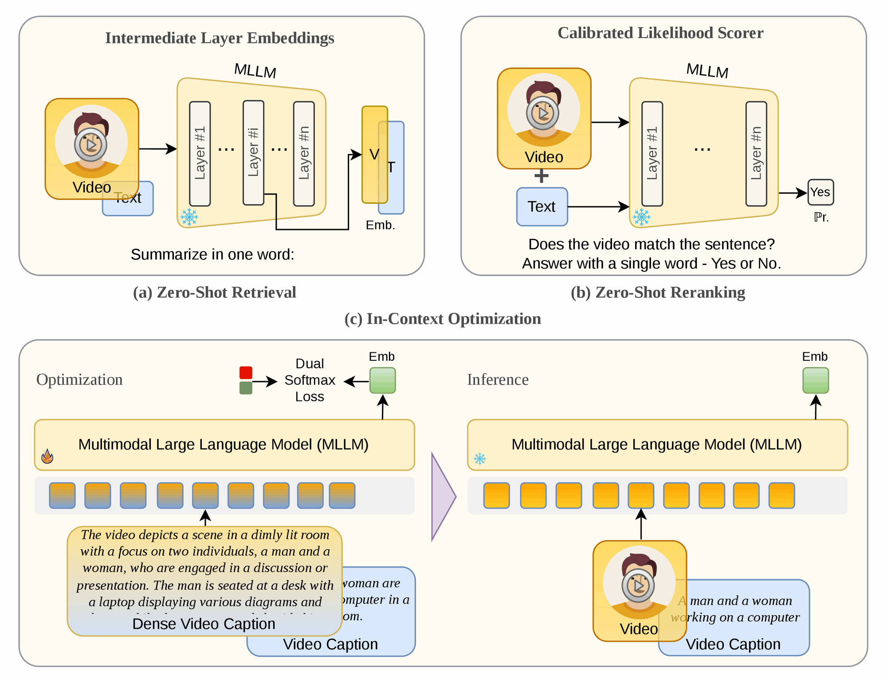
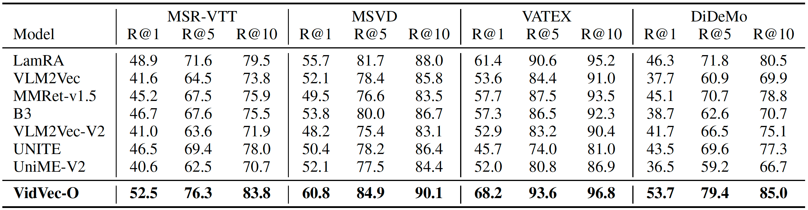
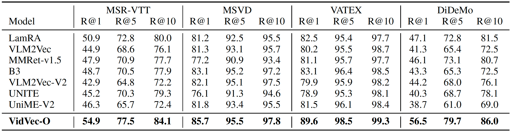

<div align="center">

<h1 align="center">VidVec: Unlocking Video MLLM Embeddings for Video–Text Retrieval</h1>

**[Issar Tzachor](https://scholar.google.com/citations?user=E2q-TI8AAAAJ&hl=en) · [Dvir Samuel](https://dvirsamuel.github.io/) · [Rami Ben-Ari](https://www.benarirami.com/)**<br>
OriginAI

**NeurIPS 2026**

[](https://iyttor.github.io/VidVec/)
[](https://arxiv.org/abs/2602.08099)
[](https://arxiv.org/abs/2602.08099)
[](https://huggingface.co/iyttor/VidVec-7B)



</div>

**(a) Zero-shot retrieval:** extract video and text embeddings from an intermediate MLLM
layer for initial ranking.
**(b) Zero-shot reranking:** leverage the calibrated MLLM head for pairwise scoring to
rerank top-K candidates.
**(c) In-context optimization:** lightweight text-only alignment of dense video captions
to short summaries, using only ~60K pairs.

> [!TIP]
> **TL;DR:** VidVec turns pretrained video MLLMs into video–text embedding models. Through
> a lightweight text-only optimization, it achieves state-of-the-art results on video–text
> retrieval. More broadly, it suggests that optimizing on text alone can be an efficient
> and effective alternative to large-scale visual supervision.

## Abstract

Recent studies have adapted generative Multimodal Large Language Models (MLLMs) into
embedding extractors for text-vision tasks, typically by fine-tuning them to produce
universal representations. However, their performance on video-text retrieval often
remains below that of dedicated Video Foundation Models. In this paper, we revisit the
video-text retrieval capabilities of MLLMs. We first analyze the zero-shot retrieval
capabilities of pretrained MLLMs and show that they already encode substantial retrieval-
relevant information: combining intermediate-layer embeddings with a calibrated MLLM head
yields strong performance without any training. To further exploit these capabilities, we
introduce a lightweight text-based optimization strategy that requires no paired
multimodal data. Our method uses dense video captions as rich textual surrogates for video
semantics and short summaries as compact, query-like views, showing that a carefully
designed text-alignment objective can improve multimodal alignment through the shared MLLM
backbone. We backup these findings through in-depth analysis. Remarkably, our lightweight
text-only optimization outperforms its counterpart trained with paired video-text
supervision, which is substantially more computationally expensive. Furthermore, our
method outperforms existing approaches, often by a substantial margin, and achieves state-
of-the-art performance across common video-text retrieval benchmarks. More broadly, our
findings highlight the untapped retrieval capabilities of pretrained MLLMs and establish
text-only optimization as a more efficient and effective substitute for large-scale visual
supervision.

## Results

### VidVec-O vs. MLLM embedders

Embeddings only, no reranking (VidVec-O in the paper). The MLLM embedders (7B) are
trained on 10–100× more vision–text data; VidVec uses about 60K text-only pairs.

**Text-to-video**



**Video-to-text**



### Two-stage VidVec vs. Video Foundation Models

VidVec never sees a video–text pair during training. Its adapter is trained in under 30
minutes on 60K pairs of *text*: a dense description of a video, which acts as a proxy for
the video itself, and a short summary of the same video, which acts as a proxy for a
search query. The video foundation models below were each trained on 10M–600M video–text
pairs.

Recall@1 on the standard test splits. VidVec's text-to-video (T2V) columns rerank the
top 5 embedding candidates.

| Method | Video–text pairs | MSR-VTT T2V | MSR-VTT V2T | MSVD T2V | MSVD V2T | VATEX T2V | VATEX V2T | DiDeMo T2V | DiDeMo V2T |
|---|---|---|---|---|---|---|---|---|---|
| InternVideo-L | 12M | 40.7 | 39.6 | 43.4 | 67.6 | 49.5 | 69.5 | 31.5 | 33.5 |
| UMT-L | 10M | 42.6 | 38.6 | 49.9 | 75.4 | – | – | 48.6 | 49.9 |
| LanguageBind | 10M | 44.8 | 40.9 | 53.9 | 72.0 | – | – | 39.9 | – |
| VideoPrism-g | 600M | 52.7 | 51.7 | – | – | 62.5 | 77.1 | – | – |
| PE-Core-G | 22M | 51.2 | 49.9 | 59.7 | 85.4 | – | – | – | – |
| InternVideo2-6B | 100M | 55.9 | 53.7 | 59.3 | 83.1 | **71.5** | 85.3 | 57.9 | **57.1** |
| **VidVec** | **0 (text only)** | **56.4** | **54.9** | **61.6** | **85.7** | 70.5 | **89.6** | **62.3** | 56.5 |

---

## Inference

Inference needs only `transformers==4.46.3`; see the
[model card](https://huggingface.co/iyttor/VidVec-7B) for requirements.

```python
from transformers import AutoModel

model = AutoModel.from_pretrained("iyttor/VidVec-7B", trust_remote_code=True, device_map="cuda:0")
score = model.similarity("video.mp4", "a man is riding a horse on the beach")

# frame sampling and prompts are keyword arguments; these are the paper's defaults
v = model.encode_video("video.mp4", fps=2, max_frames=180,
                       video_prompt="Summarize above video in one word: ")
t = model.encode_text("a man is riding a horse",
                      text_prompt="Summarize above sentence in one word: ")
```

Fewer frames lower memory use and latency. Changing a prompt changes the embedding
space, so encode videos and captions with matching settings; scores will then differ
from the paper's.

---

## Installation

Evaluation and training share one environment: Python 3.10, and `ffmpeg` on `PATH` to
decode `.mp4`.

```bash
conda create -n vidvec python=3.10 -y && conda activate vidvec
conda install -c conda-forge ffmpeg -y      # or: sudo apt-get install ffmpeg

git clone https://github.com/iyttor/VidVec.git && cd VidVec
pip install -r requirements.txt

# required for training; optional, faster attention for evaluation
pip install ninja && pip install flash-attn==2.7.4.post1 --no-build-isolation
```

`transformers` is pinned to 4.46.3. The VideoLLaMA3 model code does not run on newer
releases.

---

## Evaluation

### Requirements

One CUDA GPU with bf16 support and **≥ 32 GB** memory.

### 1. Prepare the benchmarks

Download the benchmarks from their sources:
[MSR-VTT](https://github.com/m-bain/frozen-in-time) (annotations from
[CLIP4Clip](https://github.com/ArrowLuo/CLIP4Clip)),
[MSVD](https://github.com/ArrowLuo/CLIP4Clip),
[DiDeMo](https://huggingface.co/datasets/friedrichor/DiDeMo),
[VATEX](https://eric-xw.github.io/vatex-website/) (videos from YouTube) and, optionally,
[ActivityNet](https://huggingface.co/datasets/friedrichor/ActivityNet_Captions).
Arrange them under one directory and set `VIDVEC_DATA_ROOT` to it:

```
$VIDVEC_DATA_ROOT/
├── msrvtt/       annotations/MSRVTT_JSFUSION_test.csv, videos/
├── MSVD/         raw-captions.pkl, test_list.txt, YouTubeClips/
├── didemo/       didemo_test.json, raw_videos/
├── VATEX/        jsons/vatex_validation_v1.0.json, val_all/
└── ActivityNet/  activitynet_captions_val1.json, Activity_Videos/
```

### 2. Run

From the repository root, this reproduces the paper's results:

```bash
VIDVEC_DATA_ROOT=/path/to/benchmarks ./scripts/eval.sh
```

| Option | Default | Description |
|---|---|---|
| `--datasets` | `msrvtt` | Space-separated benchmarks: `msrvtt`, `msvd`, `vatex`, `didemo`, `activitynet` |
| `--rerank-k` | `5` | Number of top text-to-video candidates to rerank. `5` gives VidVec, as in the paper; `0` skips reranking and gives VidVec-O |
| `--out` | `results/vidvec` | Output directory |
| `--resume` | off | Skip stages that already finished successfully; reranking only if run with the same `--rerank-k` |

Outputs in `--out`:

| Path | Content |
|---|---|
| `results.json` | All benchmarks, VidVec-O and VidVec, R@1/5/10 |
| `per_dataset/` | Per-benchmark retrieval (`<name>.json`) and reranking (`<name>_rerank.json`) results |
| `cands/` | Text-to-video rankings passed from retrieval to reranking |
| `logs/` | One log per benchmark and per reranking run |

---

## Training

### Requirements

4 × NVIDIA B200 (180 GB) as released; see [Other hardware](#other-hardware).
flash-attn is required (see [Installation](#installation)).

### 1. Download the training captions

Download `VideoUFO.csv` (1.2 GB) from
[VideoUFO](https://huggingface.co/datasets/WenhaoWang/VideoUFO). Only the captions are
used, not the videos. Each row's `Detailed Caption` serves as the video proxy and its
`Brief Caption` as the query proxy.

### 2. Train

From the repository root:

```bash
DATA_PATH=/path/to/data/VideoUFO.csv \
OUTPUT_DIR=/path/to/checkpoints/vidvec-7b \
bash scripts/train_vidvec.sh
```

This reproduces the released checkpoint:

- A LoRA adapter (rank 64, alpha 128) is trained on the language model. The vision encoder
  and projector stay frozen, and the base model `DAMO-NLP-SG/VideoLLaMA3-7B` is downloaded
  automatically.
- Both captions are embedded with the same prompt used at inference, and matched pairs are
  contrasted against every other pair in the batch with a dual-softmax loss.
- The global batch is 288 pairs (72 per GPU × 4 GPUs). Training stops at step 210, after
  about 60K pairs. This takes under 30 minutes on 4 × B200.

The adapter is written to `$OUTPUT_DIR/checkpoint-210` (~320 MB). `OUTPUT_DIR` must not
already exist.

### Other hardware

The loss uses every pair in the global batch as a negative, so keep the global batch at
288 to match the released model: `NUM_GPUS × PER_DEVICE_BATCH_SIZE × GRAD_ACCUM = 288`.
Data parallelism preserves the full set of negatives. Gradient accumulation does not, so
prefer more GPUs over accumulation.

| Variable | Default | Description |
|---|---|---|
| `NUM_GPUS` | `4` | GPUs on this node |
| `PER_DEVICE_BATCH_SIZE` | `72` | Caption pairs per GPU |
| `GRAD_ACCUM` | `1` | Gradient accumulation steps |
| `STOP_AT_STEP` | `210` | Step to stop and save at; `0` trains the full schedule |

---

## Acknowledgements

This code builds on [LamRA](https://github.com/Code-kunkun/LamRA). VidVec-7B is fine-tuned
from [`DAMO-NLP-SG/VideoLLaMA3-7B`](https://huggingface.co/DAMO-NLP-SG/VideoLLaMA3-7B).
Training captions come from [VideoUFO](https://huggingface.co/datasets/WenhaoWang/VideoUFO).

## Citation

```bibtex
@inproceedings{tzachor2026vidvec,
  title     = {VidVec: Unlocking Video MLLM Embeddings for Video-Text Retrieval},
  author    = {Tzachor, Issar and Samuel, Dvir and Ben-Ari, Rami},
  booktitle = {Advances in Neural Information Processing Systems (NeurIPS)},
  year      = {2026}
}
```
